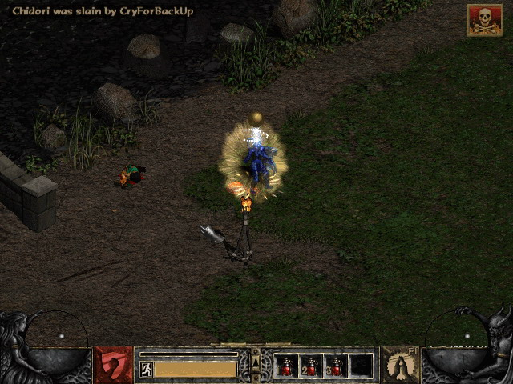
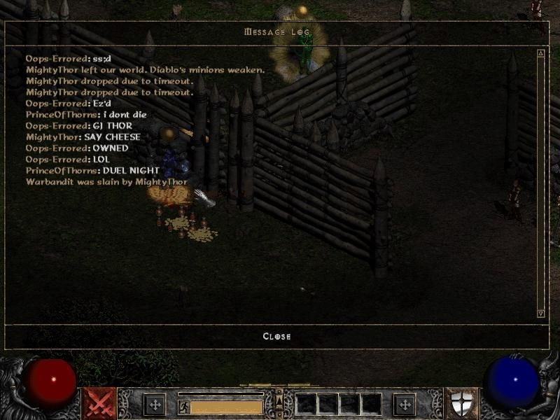
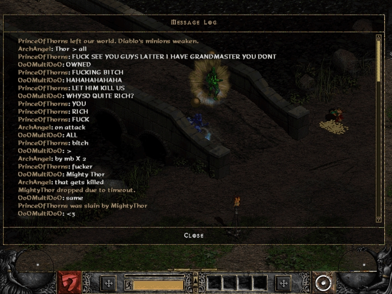
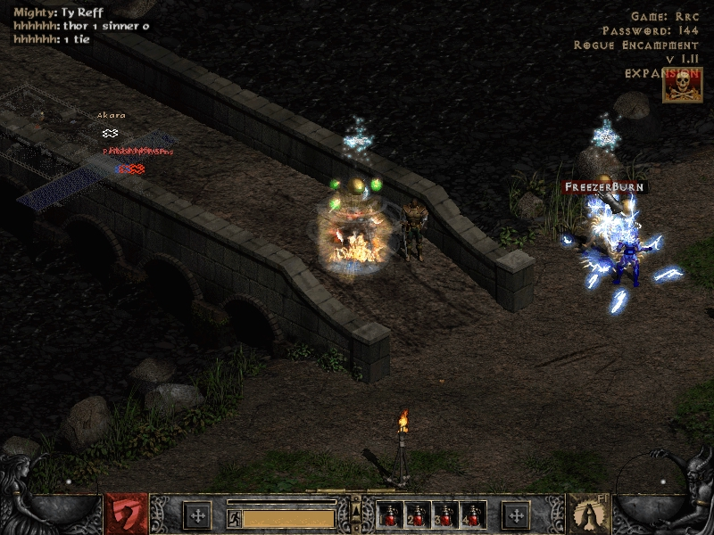
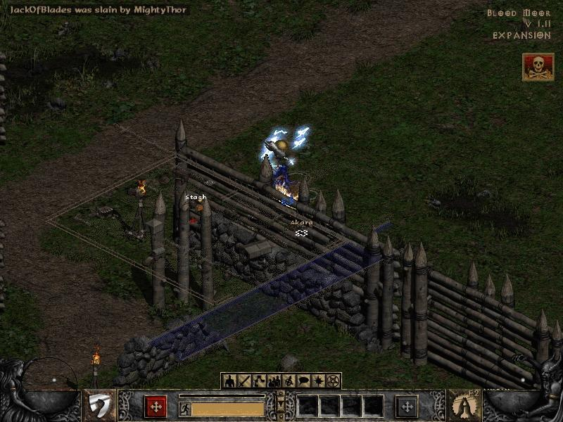
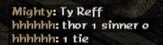

# Beyond the Realm

### A history of Diablo II Open Battle.net, LadderHall, Hackers United, and AMF

*HU_Thor / Azreal]AMF[ · roughly 2003 to 2008*

There was a time when the strongest character in Diablo II wasn't necessarily the one with the best equipment, the fastest hands, or the most hours played.

It was the one whose creator knew something nobody else did.

This is my account of that time. The names, rivalries, characters, and discoveries were real parts of a small online world that meant more to me than any other gaming community I've known.

Some of the old records still exist. Much of it survives only in memory.

**[Read the complete history and evidence archive](Open_BattleNet_AMF_LadderHall_Personal_History_Archive.txt)**

## Before the first duel

Diablo II had two very different worlds.

On Closed Battle.net, Blizzard controlled your character. On Open Battle.net, your character lived on your own computer. With tools like Hero Editor, you could change nearly anything: attributes, skills, items, sockets, auras, and values the ordinary game never intended you to use.

Then you could take that character online and fight someone else who had done the same.

At first glance, it sounds like a contest to see who could type the largest number into an editor. It wasn't. The deeper you went, the more you learned that the game had limits, exceptions, strange calculations, and interactions that could turn an apparently invincible character into a corpse.

People spent weeks testing one idea. They guarded their character files because a single file could reveal everything they had learned. When somebody discovered a new mechanic, the balance of the dueling ladder could change overnight.

The real competition happened long before anyone entered the Blood Moor. We were reverse engineering a game without access to a neat explanation of all its rules. We edited characters, changed one number, tested it against another build, watched the results, and tried to work backwards to the calculation. Sometimes the answer was an integer boundary. Sometimes it depended on which player joined the game first. Sometimes the weapon that looked strongest was actually feeding the opponent life.

There was also an information war. You could disguise your identity with an alternate character and duel someone simply to find out how their build behaved. You could watch which attacks they avoided, whether an aura healed them, whether they survived in a different join position, or what happened when you removed one particular damage source. A loss in public could still reveal what you needed for the next experiment. The more successful a player became, the more people wanted to know what was inside their character file.

Some discoveries became forum discussions and public challenges. Others stayed in private clan research threads, emails, and MSN conversations. It was closer to a small competitive reverse engineering scene than a normal PvP ladder. And because the top players were reachable in the same channels and forums as everyone else, you could test a theory against a person whose name you had been hearing for months.

We had our own ranked ladders, referees, forums, clans, arguments, and legends. The game gave us a system. We built a world around it.

What made it hard to recreate was the combination. Easy character editing gave almost anyone a way in, but the hidden mechanics gave serious experimenters years of problems to solve. Public ladders made discoveries count. Private research gave clans something to protect. Forums gave victories witnesses and reputations long memories. Modern games have modding communities, competitive ladders, and theorycrafting, but rarely all of these together in one small player-run ecosystem. That's my explanation for why I've never found the same experience again.

## Chapter I: HU_Thor

Before AMF, I was **HU_Thor**, founder of **Hackers United (HU)**.

I wanted to beat the people everyone else talked about. In that world, reputation came from challenging somebody important and proving you could win. LadderHall was where those results mattered. Its ranked duels had rules and referees, while the related forums carried the screenshots, arguments, and rivalries beyond the game itself.

AMF was the clan at the top of my list.

They were small, selective, and known for characters that seemed to operate by rules nobody else fully understood. I didn't want to admire them from a distance. I wanted HU to challenge them.

One of the people helping me was my friend Zak, known as **STORMY]**, who had become a ladder referee. We experimented with an interaction involving Life Tap curse, Smite, and extreme regeneration. Against certain high-end characters, healing itself appeared to become lethal. It was exactly the kind of discovery that could upset an established ladder ranking.

I also crossed a line: secretly involving a referee in an official match wasn't a fair test of two independently built characters. It happened, and leaving it out would make this less of a history.

The fights, screenshots, and public clashes eventually brought me into contact with the clan I'd set out to beat.

## Chapter II: Azreal]AMF[

I eventually joined AMF under the name **Azreal]AMF[**.

That changed the game for me.

AMF, short for **Alpha Mother Fuckers**, wasn't a large clan built around recruitment. Its written rules called for a small active membership, voting on recruits, and no formal hierarchy among members. Its founding history names **Thanatos, Murderin, and LouSahFur** among the central figures.

Outside the clan, we were rivals. Inside, we shared our work.

There was a private InvisionFree forum where people discussed calculations, experiments, and theories. We traded finished character files through email and MSN, and later Skype. A character save wasn't merely a build to play. It could contain the answer to a problem that had kept somebody awake for days.

I remember the trust more clearly than any formal rule. People handed over the very secrets that made their characters dangerous. As far as I remember, nobody inside AMF betrayed that trust before the community slowly faded.

A surviving AMF history from 2006 lists me as #1 on all 1.11 ladders in my prime.

## Chapter III: The people behind the characters

### Adeem: the impossible gem

**Adeem / Crucify]AMF[** was a mentor and, later, one of my fiercest rivals.

He developed remarkable builds, including one where huge negative elemental resistance and absorb could make an opponent's elemental attacks heal him instead. I remember responding by removing the elemental auras he was exploiting and turning the fight into a physical exchange + thorns.

But the memory that stayed with me wasn't a ladder result.

Adeem was working on a character that needed one more gem to reach its intended effect which was a 1 hit aura killer. The problem was simple: there wasn't room to carry it. He already knew the answer. He gave me the puzzle deliberately, because he wanted me to work it out myself rather than simply hand me a finished character and tell me the trick.

At some point, while moving another players ear item around with a full inventory of charms, I realized the inventory grid wasn't the whole inventory. You could leave an item on the mouse cursor through saving, exiting, and rejoining.

One more place to hold something. One more gem.

I told him what I had figured out. He knew I had reached the answer he had been guiding me toward, and he gave me the character. I hadn't solved a problem he was stuck on. He had taught me to notice a possibility I would otherwise have missed.

Nearly twenty years later, I still remember that moment better than most victories. We weren't just making stronger characters. The people who already understood the strange parts of the game were teaching the next person how to find them.

Our rivalry also got ugly at times. That's part of the memory too. I owe Adeem credit for his discoveries, and I regret some of the things I said to him when competing mattered more than it should have.

### Jorden: a new way to survive

**Jorden / Hades]AMF[** was another person I worked closely with.

He explored ways to stack effects through rapid equipment changes, including combinations of Oak Sage and Prayer that created extraordinary survivability. I supported giving him a chance to prove himself even though he didn't fit the usual expectation that an AMF recruit already be at the top.

He proved the ideas worked and, as I remember it, later reached #1 himself.

We spent a lot of time talking through mechanics and testing possibilities. I lost contact with him, as I did with so many people from that era.

### Thanatos and the others

**Thanatos, Murderin, LouSahFur, JayOfTeRoR**, and the rest of AMF weren't just names on a roster. We knew each other's work, argued about mechanics, and trusted each other with files that represented hundreds of hours of experimentation.

Some of those files still exist. So do traces of the emails.

## Between matches: the war for information

Think of two characters standing in a game lobby. Both look invincible. Both have equipment values that would make no sense in regular Diablo II. One player believes he has found a combination nobody can beat. The other is not necessarily trying to win the duel. He might be testing whether the first character loses life when healing triggers, whether switching from elemental to physical damage changes the outcome, or whether the same setup behaves differently when the joining order changes.

A good test isolated one question. A good rival forced you to ask a better one. It wasn't always clean science: people bluffed, hid accounts, publicly flamed one another, and sometimes manipulated situations they should not have. Espionage and research existed side by side with genuine friendships. I remember using alternate identities to gather information without exposing what I was investigating. The point wasn't merely to beat a build once. It was to understand *why* it worked, and then build something that would make it fail.

That is why AMF's private mathematical forum mattered. A screenshot could show a win. The actual knowledge lived in calculations, trial and error, arguments over mechanics, and shared save files. A new discovery could rewrite the practical rules of the ladder until someone found a counter or officials banned the interaction.

## Chapter IV: When the rules broke

The most interesting discoveries weren't always about dealing more damage. Sometimes they meant doing less damage, changing a number by one, or making an opponent's greatest strength become a weakness.

Here are a few I remember:

| Discovery | What made it matter |
| --- | --- |
| **Life lock / funky mana** | Particular Energy Shield, Telekinesis, and mana configurations could create apparent near-immunity. The exact values mattered more than the size of the number. |
| **The mosquito counter** | We experimented with summoning Act III flying monsters to disrupt mana states that ordinary attacks couldn't break. |
| **Negative resist and absorb** | Some elemental setups could turn incoming attacks into healing, forcing opponents to abandon their usual damage sources. |
| **Extreme stun and Thorns** | Rapid stun-triggered attacks could kill an opponent and also kill the attacker through reflected damage. Lowering physical damage could be the answer. |
| **Aura stacking** | Equipment changes and multiple aura sources produced unusual states that were not obvious from reading individual item properties. |
| **Submerge / Emerge** | Modified monster skills could make a dueler extremely difficult to target while offensive effects continued. The mechanic was eventually banned in the remembered ladder rules. |

For the individual experiments, numerical details, source distinctions, and related guides, see the **[full historical archive](Open_BattleNet_AMF_LadderHall_Personal_History_Archive.txt)**.

## Chapter V: What ended it

An unusually powerful character could survive an entire patch of challenges. It couldn't necessarily survive a breach of trust.

I remember a program called **D2spirate** that allowed the host of a game to steal a joining player's local character file.

A full character save was effectively the source code of your competitive advantage. Whoever acquired it could inspect the exact item properties, hidden combinations, skills, and values that might have taken you months to discover. A thief could duplicate the build, test it privately, or design a counter without doing the original research. Even if the thief never won a match, the secret was no longer yours.

That was why the character-stealing capability of **D2spirate** mattered so much. The dueling system relied on players entering games hosted by others, often with a referee present. If simply joining such a game could expose your entire character, the act required for a legitimate challenge could destroy the advantage you were trying to prove. There was no way to look at an opponent afterward and know whether they had worked out your weakness or copied the answer. It made normal testing dangerous, weakened the meaning of rankings, and made sharing new discoveries harder.

I can't establish from the surviving material how widespread use of the program was or precisely which individual stole which file. But the risk itself explains why the memory of it has such weight. Losing to someone who outsmarted you was part of the game. Losing the private research that made meaningful competition possible was something else.

The forums became quieter. People retired, changed games, moved on, or simply stopped logging in. Sites disappeared. Private discussions went with them. Even people who once talked every day could become impossible to find.

There wasn't one final duel where the world ended. Eventually, it just wasn't there anymore.

## Epilogue: What I actually miss

I can still play Diablo II. That isn't what I miss.

I miss having a problem nobody knew how to solve, thinking about it for hours, testing something absurd, and then getting on MSN to tell the one person who would understand why it mattered.

I miss knowing the names at the top of the ladder. I miss the arguments, the ridiculous screenshots, the secret characters, the forums, and the feeling that there was always one more interaction hiding inside the game.

The rankings mattered to me. So did winning. But looking back, the part that lasted wasn't being #1.

It was the people and the discoveries.

And for a while, we had a whole world built around both.

Looking back, I don't think that world could have happened at just any point in gaming history. Diablo II gave us the freedom to experiment, and the internet of that time gave our discoveries room to stay secret, our rivalries room to grow, and a handful of forums enough importance to feel like a world of their own.

We weren't simply playing a game that would one day change. We were part of a community that could only have emerged under those particular circumstances.

When the people left, the forums disappeared, and the internet changed, that world went with them.

**The game survived. The world we built around it largely didn't.**

---

## Images from the old games

These are surviving duel screenshots from the era. They're presented as glimpses of the players, chat, and screenshots people circulated, not proof that each was a formally refereed ladder match.

*One of the preserved in-game death screenshots. For a competitive scene built on public proof and reputation, an image like this was something people could bring back to the forums.*

*The message log was often as much a part of the story as the character standing on screen.*

More surviving duel screenshots

## Character files that survived

The actual character saves are included in this package for historical inspection, not as verified reproductions of specific ladder outcomes. These are modified Diablo II characters and should be examined on copies in a suitable offline environment. A save's existence doesn't establish its original author or which player first discovered a technique.

- [HackersUnited.d2s](assets/characters/HackersUnited.d2s)
- [Hexon_FF.d2s](assets/characters/Hexon_FF.d2s)
- [Hexon_iN.d2s](assets/characters/Hexon_iN.d2s)

## The surviving record

This README is the short version, told as a personal history. The account includes my memories and interpretations, alongside saved files and contemporary sources; I distinguish those where it matters. The longer archive preserves the technical material and documentation without interrupting the story.

**[Open the complete 16-section history, technical notes, and evidence inventory](Open_BattleNet_AMF_LadderHall_Personal_History_Archive.txt)**

A few places where the old world can still be seen:

- [Archived AMF forum](https://web.archive.org/web/20060831161313/http://z7.invisionfree.com/AMF/index.php)
- [House of Legends Diablo II research guides](https://houseoflegends.forumotion.com/f33-diablo-ii-hacking)
- [NightShiver / LadderHall screenshot and veteran discussion](https://www.reddit.com/r/diablo2/comments/1boysiy/for_the_neckbeards_a_glimpse_into_our_glorious/)
- [Open Battle.net veteran reunion discussion](https://www.reddit.com/r/diablo2/comments/lsmm01/anyone_still_do_open_bnet_duels_with_hex_edited/)

